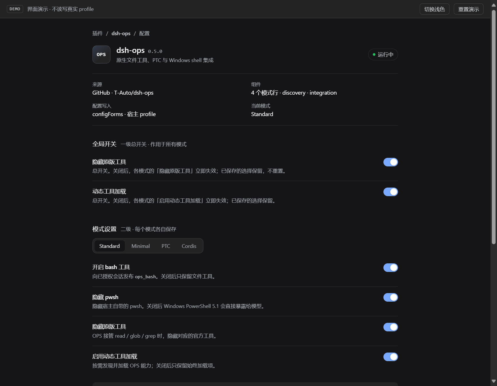
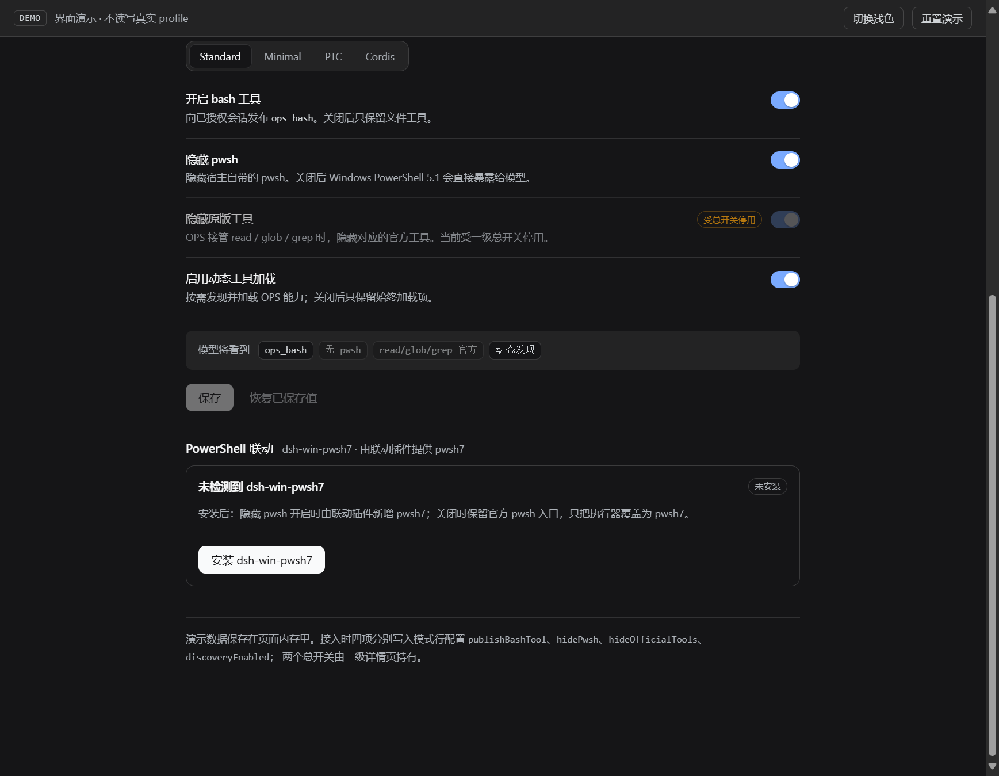
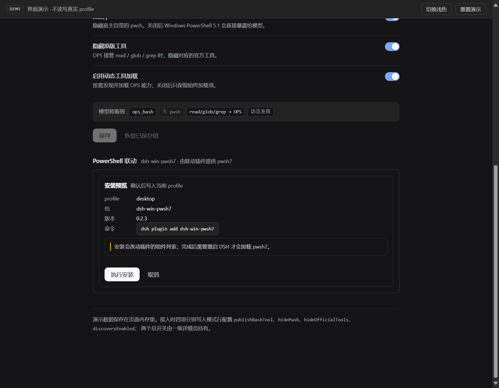
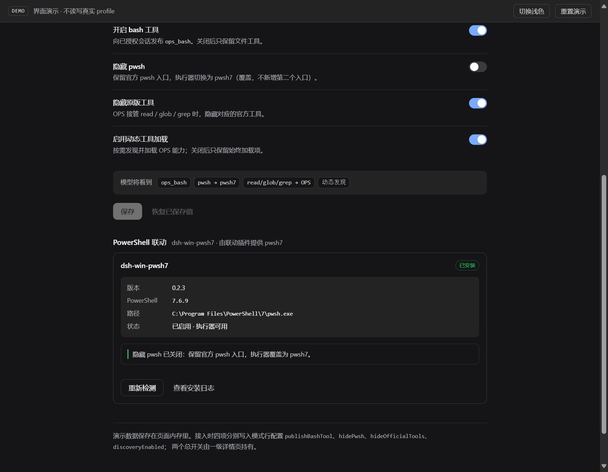
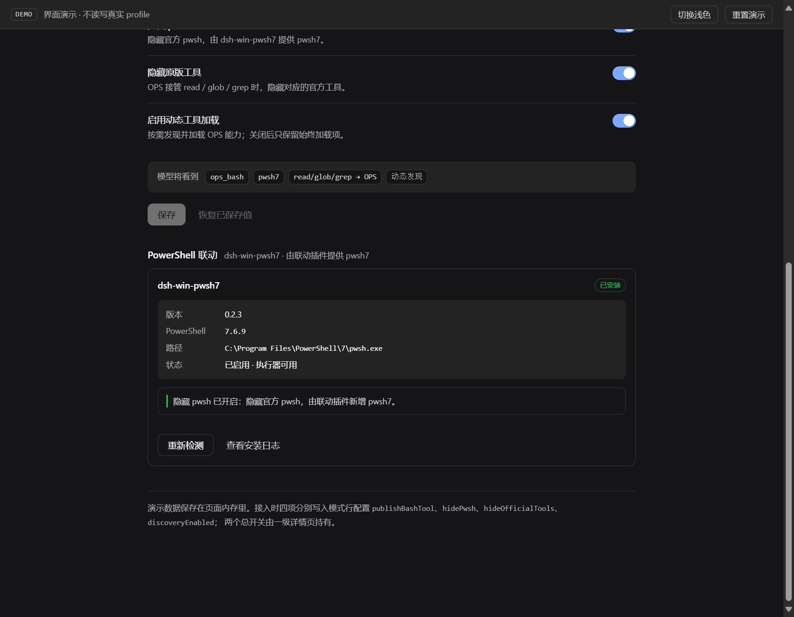
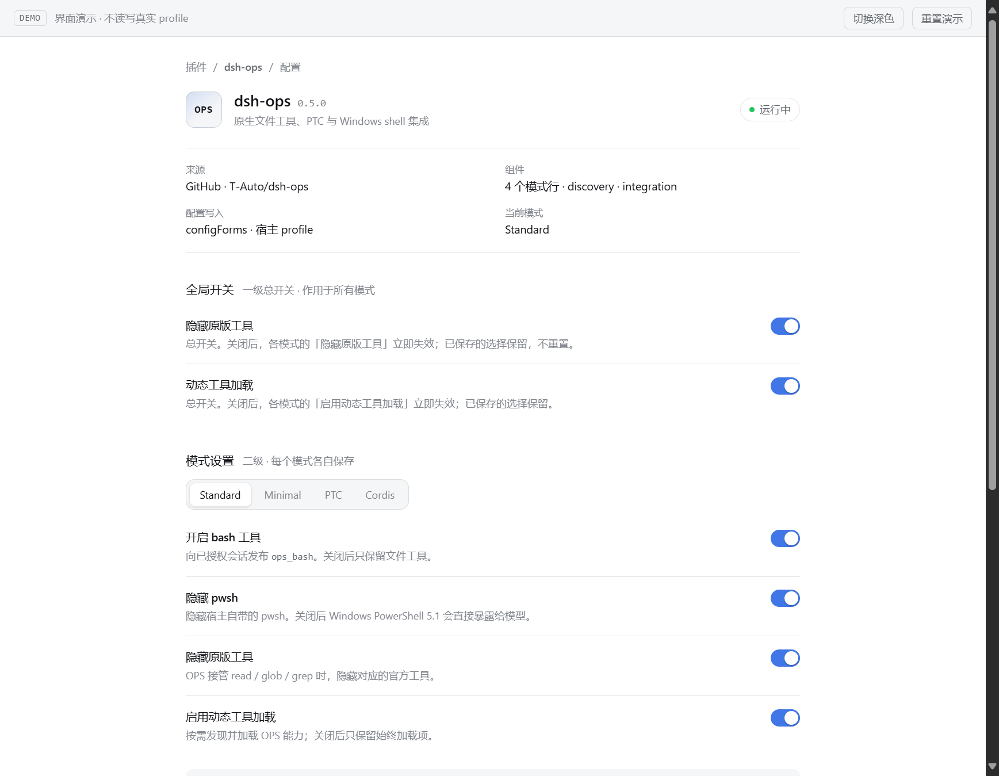

# PowerShell 联动设置 · 控制界面 demo

面向 [dsh-ops#462](https://github.com/T-Auto/dsh-ops/issues/462) 的可评审 demo：把「优化原版模式」的四个开关、两个一级总开关，以及 dsh-win-pwsh7 的覆盖/新增四态，做成一页可点的原生风格界面。

**它不读写真实 profile。** 页面状态只保存在内存里，安装过程是模拟的；接入方式见下面「接到 OPS 里」。

## 打开

直接双击 `index.html`，或在本目录起一个静态服务：

```console
python -m http.server 8791 --bind 127.0.0.1
# http://127.0.0.1:8791/
```

右上角可以切换深/浅色、重置演示。

评审时可以直接跳到固定状态，不用手动拨：

| URL | 状态 |
| --- | --- |
| `index.html` | 默认：四项全开，未安装联动插件 |
| `index.html?state=gated` | 关闭「隐藏原版工具」总开关 |
| `index.html?state=added` | 已安装联动插件 + 隐藏 pwsh 开（新增 `pwsh7`） |
| `index.html?state=override` | 已安装联动插件 + 隐藏 pwsh 关（覆盖执行器） |
| `index.html?state=preview` | 安装预览面板 |
| `index.html?state=light` | 浅色主题 |

## 文件

| 文件 | 作用 |
| --- | --- |
| `index.html` | 自包含的交互 demo：四个开关、两个总开关、pwsh 四态、安装预览/执行/重启提示 |
| `model.mjs` | 纯状态模型：`checked` / `enabled` / `applies` 三层语义、pwsh 四态、模型可见工具摘要 |
| `model.test.mjs` | `node --test model.test.mjs`，覆盖默认值、总开关门控、四态、覆盖不新增 |
| `section.tsx` | 参考 React 实现：`ShellOptionsSection` + `LinkedShellCard`，受控、无宿主读写 |

## 截图

| 默认（深色） | 总开关关闭 |
| --- | --- |
|  |  |

| 安装预览 | 覆盖态（隐藏 pwsh 关） |
| --- | --- |
|  |  |

| 新增态（隐藏 pwsh 开） | 浅色 |
| --- | --- |
|  |  |

## 交互里要看的几点

1. **总开关关闭**：子项保留原来的开关值，只变成禁用并显示「受总开关停用」；行摘要出现「N 项被总开关停用」。恢复总开关后原值还在，不需要重新拨。
2. **pwsh 四态**（拨「隐藏 pwsh」+ 安装/未安装联动插件）：
   | 隐藏 pwsh | dsh-win-pwsh7 | 模型看到 |
   | --- | --- | --- |
   | 开 | 未安装 | 无 PowerShell 工具 |
   | 开 | 已安装 | `pwsh7`（新增） |
   | 关 | 未安装 | `pwsh`（Windows PowerShell 5.1） |
   | 关 | 已安装 | `pwsh`（执行器覆盖为 pwsh7，不新增第二个入口） |
3. **模型可见工具**：底部 chips 跟着生效态走，不是跟着已保存值走。
4. **安装入口**：预检显示 profile / 包 / 版本 / 命令；执行后给出步骤，结束提示「需要重启 DSH」。
5. **禁用的插件**：真实接入时一级详情页在插件禁用态只保留身份/来源，本 demo 没模拟这一层。

## 接到 OPS 里

组件是受控的，宿主侧只需要两件事：

```tsx
<ShellOptionsSection
  value={draft}                 // 四个键的当前值
  masters={masters}             // 两个一级总开关
  linked={linked}               // { state: 'missing' | 'installed', version, pwshVersion, path }
  onChange={(patch) => edit({ ...draft, ...patch })}
/>
```

保存仍然走现有 `configForms`，四个键分别 `set` / `unset`：

```js
form.mutate([
  { op: 'set', path: ['publishBashTool'], value: draft.publishBashTool },
  { op: 'set', path: ['hidePwsh'], value: draft.hidePwsh },
  { op: 'set', path: ['hideOfficialTools'], value: draft.hideOfficialTools },
  { op: 'set', path: ['discoveryEnabled'], value: draft.discoveryEnabled },
], revision)
```

- `section.tsx` 里的 `SHELL_CSS` 粘到 `src/client/styles.ts` 的 `SETTINGS_CSS` 旁边。
- `Switch` 用宿主 primitives，颜色只用 `--dsw-alias-*`，不需要第二套主题。
- `LinkedShellCard` 的安装动作建议由联动的 dsh-win-pwsh7 提供（预检/执行/重启提示），OPS 只调一个动作，不把 npm 命令写死在 OPS 里。

## 还没定的两件事

1. **新增那格的工具名**：demo 按 issue 里的描述用了 `pwsh7`；如果希望模型侧永远只看到 `pwsh`，可以改成同名遮蔽（OPS 的 provider 优先级机制本来就能按名字替换），这样提示词和工具引用不用随开关切换两套名字。
2. **一级总开关的宿主位置**：demo 把两个总开关和模式设置画在同一页；接入时它们应由 bundle 详情页持有，模式行只保留四个子项。

## English

A self-contained, interactive mock of the OPS settings surface proposed in dsh-ops#462: four per-mode switches, two bundle-level masters, the four pwsh coexistence states, and the linked-plugin install flow. Open `index.html` directly or serve the folder; state stays in memory and the install is simulated.

`model.mjs` is the tested state model (`node --test model.test.mjs`); `section.tsx` is the controlled React reference that consumes it and renders with the host `Switch` plus `--dsw-alias-*` tokens. Both are demo artefacts outside the `src` build root.
